# RoboCup OpenCV Vision Lab

[](https://github.com/xunju/robocup-opencv-vision-lab/actions/workflows/ci.yml)


基于 RoboCup 视觉组第二次培训作业整理的 **Python / OpenCV 传统视觉实验项目**。围绕图像与视频读写、像素操作、预处理、特征提取和几何检测，提供 5 个可独立运行的模块，以及统一命令行、结果报告和自动验证。

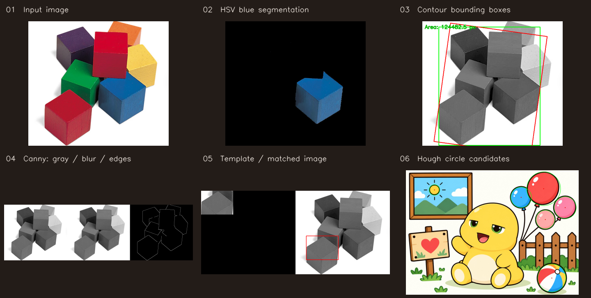

*从左到右、从上到下：输入图像、HSV 蓝色分割、轮廓与外接矩形、Canny 边缘、模板匹配、霍夫圆检测。预览由项目实际运行结果生成。*

## 项目功能

| 模块 | 实现内容 | 主要输出 |
| --- | --- | --- |
| `task1_gui_draw.py` | 彩色/灰度读写，线段、矩形、圆、椭圆、多边形与文字绘制 | 画布、灰度图、手工标注图 |
| `task2_video.py` | 获取分辨率/FPS，逐帧标注，MP4 编码，按间隔抽帧 | 标注视频、可选帧图像 |
| `task3_core.py` | 像素读写、ROI、通道拆分、蓝通道反相、边界扩展、图像加法/融合、掩膜、灰度转换耗时对比 | 13 张对照图、耗时记录 |
| `task4_basic.py` | HSV 阈值分割、缩放/平移/旋转/透视变换、4 种滤波、腐蚀/膨胀/开闭运算 | 分割图、变换图、滤波与形态学对照图 |
| `task5_advanced.py` | Sobel/Laplacian/Canny、图像金字塔、轮廓筛选、外接矩形、直方图均衡化、模板匹配、霍夫直线/圆 | 12 张结果图、检测数量与匹配位置 |

这里的目标定位由阈值、轮廓、模板匹配和霍夫变换完成；模块 1 的框是绘图练习中的手工标注。项目未训练神经网络，也未接入机器人控制或比赛现场系统。

## 各任务结果展示

[任务 1：绘图](#task-1) · [任务 2：视频](#task-2) · [任务 3：核心操作](#task-3) · [任务 4：基础处理](#task-4) · [任务 5：进阶算法](#task-5)

以下图片与动画均由本仓库实际处理结果生成。图片保留原始长宽比，点击可查看大图；深色留白用于排列不同尺寸的输出。

<a id="task-1"></a>

### 任务 1：图像读写与绘图

左至右为几何图形画布、灰度转换和手工矩形标注。画布包含线段、矩形、圆、椭圆、多边形与文字。

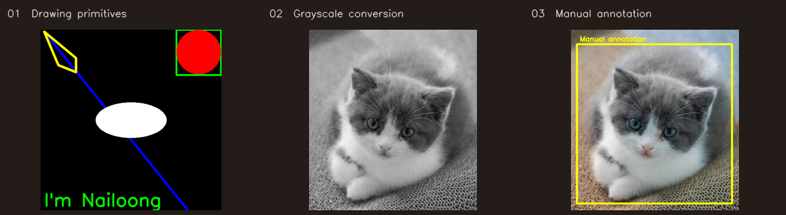

```bash
python run.py --task 1
```

<a id="task-2"></a>

### 任务 2：视频逐帧处理与抽帧

**动画预览：** 前 8 秒，缩小至 360 像素宽，以约 8 FPS 循环播放。左上角显示对应源视频的实际帧编号与时间。

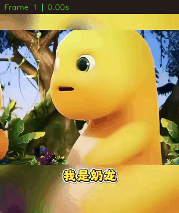

**[查看完整标注视频（MP4，约 17.53 秒）](docs/results/task2_annotated.mp4)** · [查看原始输入视频](videos/nailoong.mp4)

完整输出保留 830 × 986 分辨率和 30 FPS，共 526 帧；仓库展示版转为 H.264 方便播放器打开。下图依次为首帧、中间帧和末帧，运行时还可通过 `--extract-every` 控制抽帧间隔。

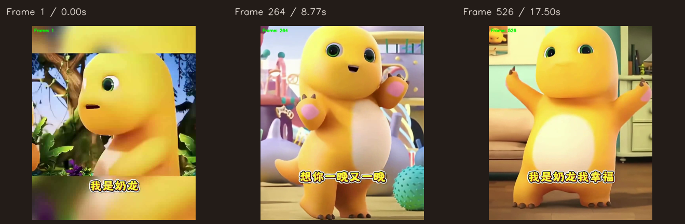

```bash
python run.py --task 2 --extract-every 30
```

<a id="task-3"></a>

### 任务 3：ROI、通道、运算与掩膜

从左到右、从上到下：将左半图复制到右侧、只反相蓝色通道、两帧按 0.3/0.7 加权融合、圆形 ROI 掩膜。

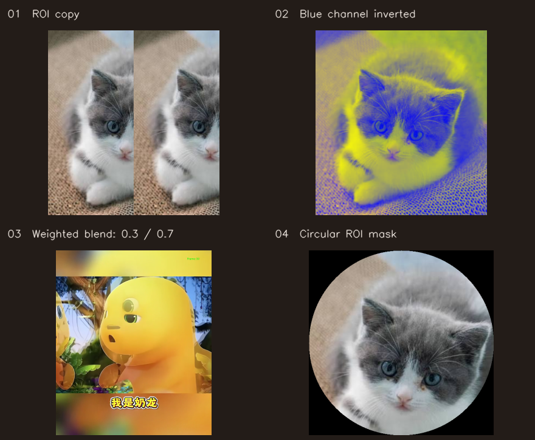

<details>
<summary>展开查看通道拆分、饱和加法与回绕、边界及灰度对照</summary>

**通道拆分：** 蓝、绿、红通道分别以灰度图显示各自的像素强度。

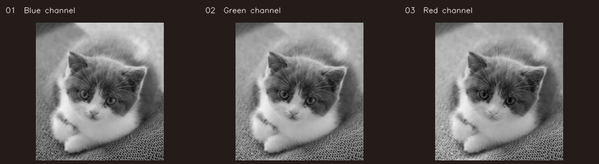

**图像运算：** 左至右为 OpenCV 饱和加法、NumPy uint8 回绕加法、加权融合。

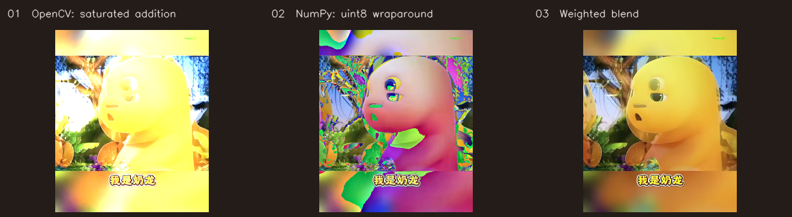

**边界与灰度：** 上排为常量边界、反射边界；下排为同一个 64 × 64 片段的手工灰度与 OpenCV 灰度转换，放大展示便于对照。

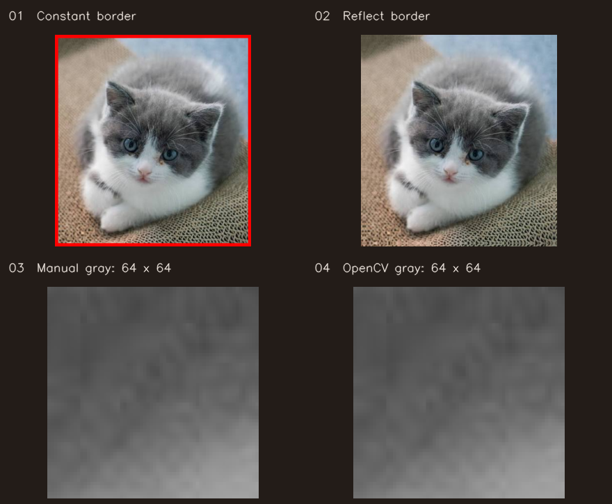

</details>

```bash
python run.py --task 3
```

<a id="task-4"></a>

### 任务 4：颜色分割、几何变换与预处理

第一排：原图、HSV 蓝色分割、分割二值掩膜。第二排：平移、旋转 90°、对选定积木进行透视变换。

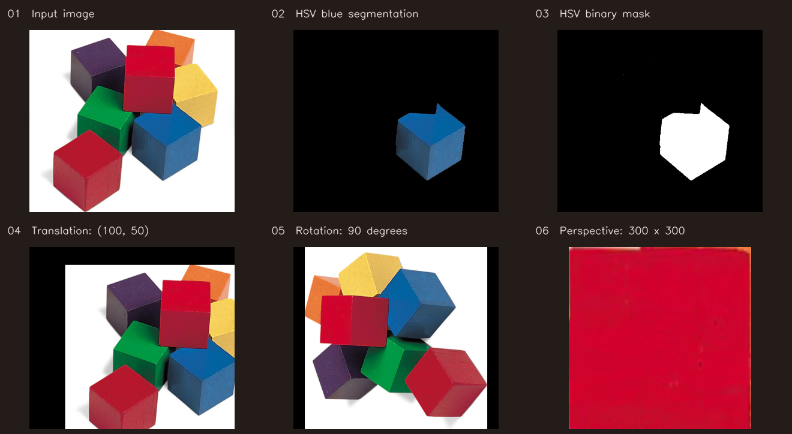

**滤波对照：** 原图、均值滤波、高斯滤波、中值滤波、双边滤波。

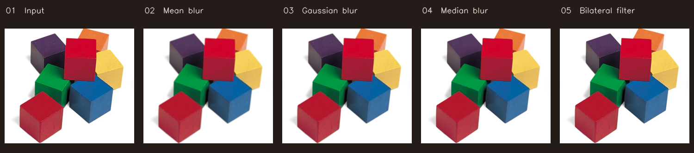

**形态学对照：** 二值图、腐蚀、膨胀、开运算、闭运算，使用 5 × 5 椭圆结构元素。

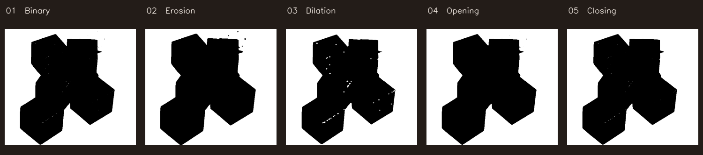

<details>
<summary>展开查看缩放结果</summary>

原图、三次插值放大 2 倍、区域插值缩小至 0.5 倍。展示时各图等比适配画格，完整输出尺寸保留在 `output/` 中。

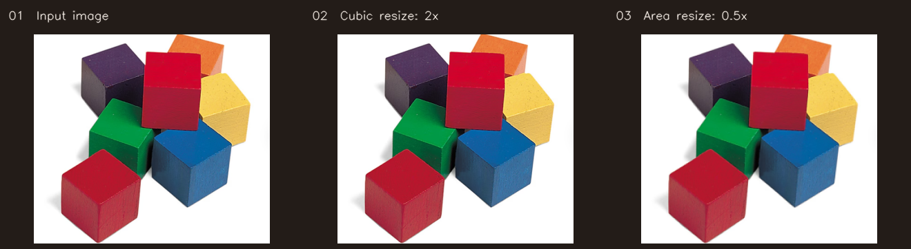

</details>

```bash
python run.py --task 4
```

<a id="task-5"></a>

### 任务 5：轮廓分析、模板匹配与霍夫检测

**轮廓处理：** 所有轮廓、面积大于 100 px² 的轮廓、最大轮廓、最大轮廓的外接矩形。绿色为轴对齐矩形，红色为最小面积旋转矩形。

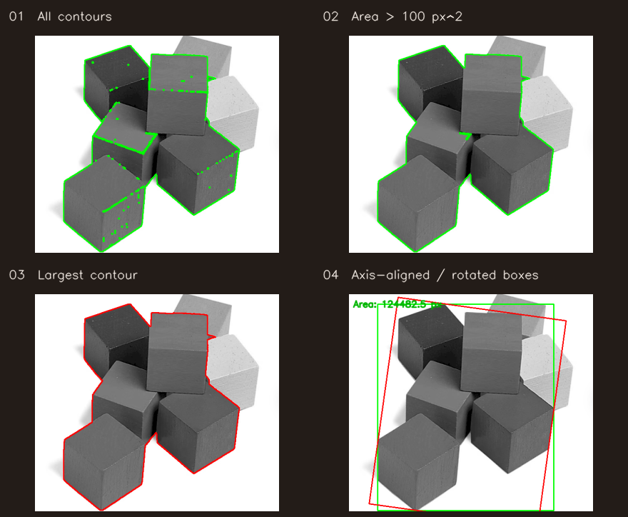

**模板匹配：** 左侧为模板示意，右侧红框为匹配位置。当前模板来自同一张原图，定位结果为 `(65, 275)`。

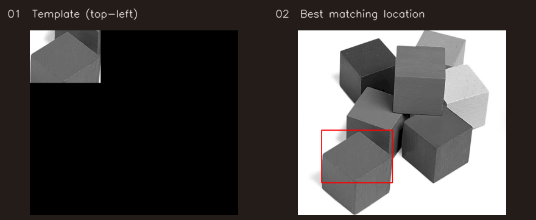

**霍夫检测：** 左侧红线为线段候选；右侧绿色圆周与红色圆心为圆候选。

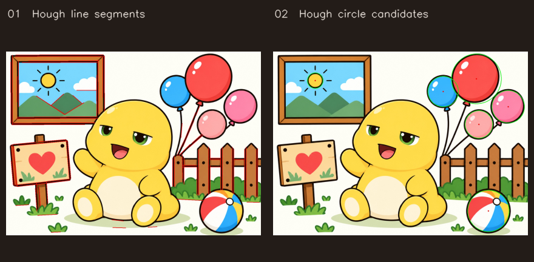

<details>
<summary>展开查看梯度、Canny阈值、图像金字塔与直方图均衡化</summary>

**梯度：** 原灰度图、Sobel X、Sobel Y、Laplacian。

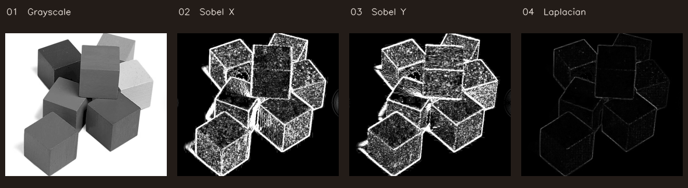

**Canny 阈值：** 左侧为 50/150，右侧为 100/200；均先进行 5 × 5 高斯平滑。

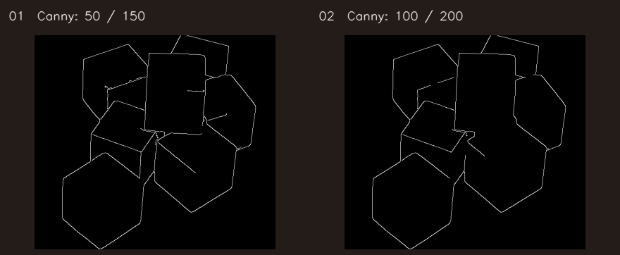

**金字塔与均衡化：** 上排为原图与金字塔重建图；下排为灰度原图与直方图均衡化结果。

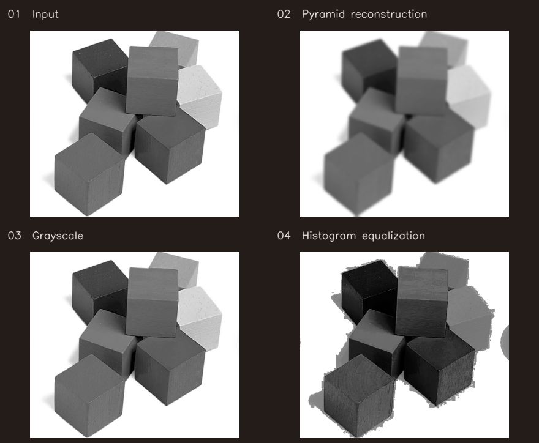

</details>

```bash
python run.py --task 5
```

## 快速开始

建议使用 Python 3.10–3.12。已在 Windows / Python 3.12.7 / OpenCV 4.11.0 / NumPy 2.0.2 下完成本地验证。

```bash
git clone https://github.com/xunju/robocup-opencv-vision-lab.git
cd robocup-opencv-vision-lab
python -m venv .venv
```

Windows PowerShell 激活环境：

```powershell
.\.venv\Scripts\Activate.ps1
```

macOS / Linux 激活环境：

```bash
source .venv/bin/activate
```

安装并运行全部实验：

```bash
python -m pip install -r requirements.txt
python run.py
```

默认无需图形界面，也无需按键；完整处理内置视频，将实验图像、`annotated_video.mp4` 和 `report.json` 写入项目的 `output/`。结果目录已加入 `.gitignore`，不会反复提交生成文件。

## 运行示例

```bash
# 只运行进阶图像处理
python run.py --task 5

# 每 30 帧保存一张图像，并处理完整视频
python run.py --task 2 --extract-every 30

# 快速体验：视频最多处理 60 帧，图像实验仍全部执行
python run.py --max-frames 60

# 使用自己的视频
python run.py --task 2 --video /path/to/input.mp4

# 将结果写入指定目录
python run.py --output-dir ./output/demo

# 打开图像预览；视频按 q 结束，静态图按任意键继续
python run.py --task 1 --show

# 每个任务也可以独立运行
python task4_basic.py
```

路径相对于脚本位置解析，因此可以从其他工作目录通过脚本绝对路径启动。`--assets-dir` 可指定包含 `images/` 和 `videos/` 的素材根目录；图像实验中的 ROI、透视点和模板裁剪针对内置素材设置，替换图像时需同步调整。

## 实际运行结果

一次本地完整运行 `python run.py --extract-every 30` 得到：

| 验证项 | 本次结果 |
| --- | --- |
| 图像输出 | 37 张，覆盖 4 个静态图像模块 |
| 视频处理 | 830 × 986，30 FPS，共 526 帧；按间隔额外导出 17 张帧图 |
| 轮廓分析 | 142 条轮廓，面积大于 100 px² 的轮廓 2 条 |
| 模板匹配 | 最佳位置 `(65, 275)`，归一化相关系数 `1.0` |
| 霍夫变换 | 95 条线段、6 个圆候选 |
| 灰度转换对照 | 64 × 64 样本，手工计算与 OpenCV 最大像素差为 1 |

完整指标见 [示例报告](docs/sample_report.json)。模板取自同一张输入图像，分数用于验证算法调用与定位流程；霍夫数量为当前参数下的候选数，未经过人工真值评估。灰度耗时为单次测量，不作为通用性能结论。

## 验证

```bash
python -m unittest discover -s tests -v
```

6 项检查覆盖饱和加法与 uint8 回绕、通道反相不修改输入、中文路径读写、空轮廓/空直线处理，以及从其他目录运行全部任务并重新解码输出视频。GitHub Actions 配置在每次推送和 PR 时运行这些检查；远端运行状态请查看顶部徽章。

### 重新生成 README 展示素材

```bash
python -m pip install -r requirements-demo.txt
python run.py --extract-every 30
python tools/build_showcase.py
```

展示脚本将实际输出整理为 `docs/results/` 中的分任务拼图与 GIF。若系统可找到 FFmpeg，还会从完整标注视频编码生成 H.264 MP4；GIF、拼图和主程序运行无需 FFmpeg。

## 目录

```text
.
├── run.py                     # 统一入口与 JSON 报告
├── common.py                  # 路径、图像读写、预览
├── task1_gui_draw.py
├── task2_video.py
├── task3_core.py
├── task4_basic.py
├── task5_advanced.py
├── images/                    # 原作业中的 5 张输入图像
├── videos/                    # 原作业中的输入视频
├── docs/                      # 预览、分任务图集、GIF/MP4、报告、项目经历说明
├── tools/build_showcase.py     # 从实际输出生成展示素材
├── tests/                     # 数值与流程检查
├── .github/workflows/ci.yml
├── requirements.txt
└── requirements-demo.txt       # 展示素材生成的额外依赖
```

## 作为项目经历展示

可使用的项目名称：**基于 OpenCV 的图像与视频处理实验平台**。

> 基于 Python、OpenCV 与 NumPy 完成 5 个视觉实验模块，实现视频逐帧处理、HSV 颜色分割、几何变换、滤波与形态学处理、轮廓分析、模板匹配及霍夫检测；将培训作业整理为统一命令行项目，增加可配置抽帧、JSON 结果报告与自动检查，支持中文路径和无窗口批量复现。

更详细的简历要点、技术解释和实验边界见 [项目经历说明](docs/PROJECT_EXPERIENCE.md)；原始作业到当前仓库的对应关系见 [整理说明](docs/IMPLEMENTATION.md)。

## 素材说明

`images/` 与 `videos/` 沿用第二次任务的本地素材，未重新创作这些素材；原文件未附完整的上游来源信息。`docs/preview.png` 与 `docs/results/` 为这些素材的算法处理结果及展示用转换版本。本仓库未附统一开源许可证。
